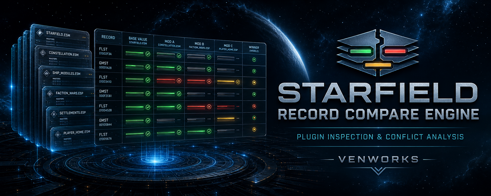

# Creations Forge



Creations Forge is a cross-platform Bethesda plugin authoring application for Starfield, Fallout 4, and Skyrim Special Edition. It gives mod authors an MCP-compatible workflow for creating new plugins and opening, inspecting, comparing, editing, and saving existing plugins.

The application is currently undergoing a complete rebuild. Untagged development builds may contain only part of the product workflow and should not be used for production mod authoring.

## Features

1. Opens existing Bethesda plugins and creates new plugin files for Starfield, Fallout 4, and Skyrim Special Edition.
2. Browses records, resolves references, and compares record data across plugin contexts.
3. Edits records through typed game-aware workflows and saves changes to an explicitly selected output plugin.
4. Reviews staged changes, validation warnings, and save outcomes before replacing output files.
5. Supports local MCP-compatible automation without requiring an application database as the record authority. The desktop GUI returns in a later presentation project.
6. Keeps source plugins separate from editable output and provides guarded save and recovery workflows.

## Installation

Install a published release from the [GitHub Releases](https://github.com/monster-cookie/CreationsForge/releases) page. Development branches are not end-user packages.

| Platform | MCP package | Native package |
| --- | --- | --- |
| Windows x64 | `CreationsForge-Mcp-win-x64-<version>.zip` | `CreationsForge-Setup-<version>.exe`, containing the MCP host |
| Ubuntu/Debian x64 | `CreationsForge-Mcp-linux-x64-<version>.zip` | `CreationsForge_<version>_amd64.deb`, containing the MCP host and the `creationsforge-mcp` launcher |
| Arch Linux x64 | The `linux-x64` MCP archive can be extracted directly | `creationsforge-<version>-1-x86_64.pkg.tar.zst`, containing the MCP host and the `creationsforge-mcp` launcher |
| macOS Intel | `CreationsForge-Mcp-osx-x64-<version>.tar.gz` | None |
| macOS Apple Silicon | `CreationsForge-Mcp-osx-arm64-<version>.tar.gz` | None |

The macOS archives are unsigned and unnotarized. macOS may warn about or block their first launch according to the system's security settings. Intel and Apple Silicon are separate native packages; no universal binary is provided.

1. Download the package for your platform and install or extract it outside the game's `Data` directory.
2. Keep the game's installed plugins and required masters available through the game's normal data path or supported mod-manager setup.
3. Configure the MCP executable in a compatible client. The desktop GUI is not part of this rebuild.
4. Keep source plugins backed up and select a separate output path until you have reviewed and tested saved changes.

## Development and Contribution

Install the .NET 10 SDK, create a focused working branch from `master`, and keep changes aligned with the existing project boundaries. New behavior should include focused automated coverage, and user-visible changes should update the applicable public documentation.

Restore, build, test, and verify formatting from the repository root:

```powershell
dotnet restore .\CreationsForge.sln
dotnet build .\CreationsForge.sln --configuration Release --no-restore
dotnet test .\CreationsForge.UnitTests\CreationsForge.UnitTests.csproj --configuration Release --no-build --no-restore
dotnet format .\CreationsForge.sln --no-restore --verify-no-changes
```

Before opening a pull request, review the complete diff, confirm that no generated output or machine-specific files are included, and make the pull request ready for review rather than a draft. Pull requests run CI; release packaging runs only for a newly created `v<major>.<minor>.<patch>` tag that points to the current `master` commit.

## MCP Development Host

Configure a stdio-capable MCP client to launch the dedicated MCP executable without command-line arguments. The production host exposes `server_info`, `record_types`, `record_schema`, `workspace_open`, `workspace_state`, `workspace_close`, `records_search`, `record_read`, `record_compare`, `output_create`, `output_open`, `record_create`, `record_override`, `record_apply`, `workspace_preview`, `workspace_save`, and `workspace_discard`. Mutating tools require an `operationId` of at most 128 characters. An identical operation id and payload is replayed for the life of the process and is not persisted across a restart. Reusing an operation id with a different payload returns `replay_conflict`. An evicted operation id returns `replay_expired` and is not executed again. A new operation id is refused with `replay_capacity` when the replay cache cannot record it, and that refusal is not executed.

From the repository root after a Release build:

```powershell
dotnet .\CreationsForge.Mcp\bin\Release\net10.0\CreationsForge.Mcp.dll
```

This starts a protocol server, not an interactive shell. Protocol messages use standard input and output; diagnostics use standard error. The executable rejects command-line arguments with exit code 2.

The host tests in `CreationsForge.UnitTests/McpHost` start that executable and carry session, revision, and operation identifiers between calls. Those tests are how the tool sequence is run.

## Social Presence

1. I can be found as Venpi hanging out in the Quarter Onion Games Discord server.
2. You can follow me on X as [@monstercookiebd](https://x.com/monstercookiebd).
3. You can follow me on Threads as [@monstercookiebd](https://www.threads.net/@monstercookiebd).
